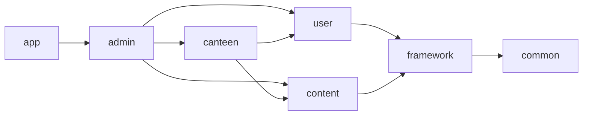

# 代码结构与扩展入口

后端是 Java 21 的 Maven 多模块工程，前端是原生微信小程序。管理页面也在小程序中，没有另一个 Web 管理站。

## 模块

| 目录 | 负责内容 |
|---|---|
| `speakToMe-common` | 错误码、业务异常、AES 工具 |
| `speakToMe-framework` | 统一响应、分页、会话、登录拦截、限流、MyBatis 配置 |
| `speakToMe-user` | 微信凭证交换、用户资料、校区选择 |
| `speakToMe-content` | 本地词库、微信内容审核、举报、审核日志归档 |
| `speakToMe-canteen` | 校区、地点、档口、菜品、点评、评分、榜单 |
| `speakToMe-admin` | 角色检查、复审、举报处理、对象和敏感词维护 |
| `speakToMe-app` | 启动入口、配置校验、demo 隔离、Flyway、健康检查和数据库命令 |
| `miniprogram` | 页面、请求封装、主题和环境选择 |

实际模块依赖在各模块 `pom.xml`。概览如下，不表示所有模块互相依赖：

## 顺着请求读代码

### 登录和会话

`miniprogram/pages/auth/login.js` 获取 code → `AuthController.login` → `AuthService.login` → `WechatClient.code2Session`。后端按 openid 摘要查用户，保存 AES 密文，调用 `SessionService.create` 签发 Redis 会话。客户端保存 token，后续由 `miniprogram/utils/request.js` 放到 Authorization 请求头。

`LoginInterceptor` 校验会话并写入 `UserContext`，请求结束清理线程上下文。公开路径以框架的拦截器配置为准，详见[API参考](API参考.md)。管理请求还要经过 `AdminGuard.requireAdmin`，重新查询 role=1、status=1；前端隐藏按钮不构成权限校验。

### 点评、审核和评分

`ReviewController.submit` 做用户限流 → `ReviewService.submit` 校验评分、正文和菜品 → 本地敏感词 → 微信文本审核 → 保存审核状态和日志。

- 本地直接拦截：记录没有 reviewId 的日志，不创建点评。
- 微信通过且本地不要求复审：状态 1，进入公开点评与评分。
- 微信建议复审、本地要求复审或微信服务异常：状态 3，仅作者和管理接口可见。
- 微信拦截：状态 2，保留被拦截点评和审核记录，对外返回业务拒绝。

`ContentBlockedException` 特意不触发整笔事务回滚，以保留已经完成的审核记录；数据库等其他异常仍回滚。不要把所有业务异常都加入 noRollbackFor。

`DishService.refreshRating` 从审核通过、未删除的 food/dish 点评重算菜品平均分和人数，再删除评分分布缓存。本人删除、人工复审和举报下架也会改变评分。地点表虽有评分字段，当前没有地点级评分聚合链路。

### 榜单与缓存

`DishMapper.selectHotDishes` 聚合近期点评，`RankingService` 每十分钟重建 7/30 天 Redis ZSET。接口读缓存的顺序，但仍查询 MySQL 取得当前条目；空缓存实时计算，不是纯 Redis 查询。热度公式和缓存键见[数据字典](数据字典.md)。单个点评变化不会立即重建整个榜单。

### 举报和人工处理

`ReportService.submit` 校验公开评论，用 Redis 做 24 小时去重，并在数据库事务中更新计数与工单。前端不展示本人点评的举报入口，但后端尚未显式禁止自举报，不能将页面限制当成服务端约束。`AdminReportController.handle` 条件更新待处理工单，block 时锁评论并下架；dismiss 不改变点评。`AdminAuditController.confirm` 用 pass/block 完成复审、下架或恢复。

### 启动和归档

配置校验 → Flyway → 词库读取等业务初始化。demo 专用配置与生产隔离。`AuditArchiveService` 每天处理过期日志，持久化文件及校验成功才删库；文件失败或删除失败保留原记录。恢复和回滚边界见[部署与运维](部署与运维.md)。

## 如何增加功能

| 修改目标 | 最小涉及位置 | 要验证的内容 |
|---|---|---|
| 增加页面 | `miniprogram/pages`、`app.json`，复用请求和主题工具 | 注册、登录跳转、空/错/加载态、日夜主题、页面逻辑测试及微信渲染 |
| 增加业务字段 | 新 Flyway 迁移、实体、请求/响应、页面 | 空库和存量升级、默认值、权限与序列化；同步数据字典 |
| 增加受保护接口 | 所属模块 Controller/Service，返回 Result | 真实登录拦截、越权拒绝、事务失败；同步 API 文档 |
| 修改审核 | `SensitiveWordFilter`、`WechatContentClient`、`ReviewService` | 放行/拦截/异常降级、日志保留、评分与可见范围 |
| 增加业务模块 | 新 Maven 模块、父 POM 和 app 依赖 | 避免反向依赖；模块权限、迁移和独立测试 |

目前点评只实现菜品流程；`module` 虽能保存其他非空字符串，但查询和评分固定使用 food/dish，不能仅改一个参数就接入交易或课程。`post`、`trade_order` 只是预留表，没有对应可用服务。新模块需要自己的参数白名单、目标校验、权限及审核接入。

当前仍缺多实例词库同步、并发评分缓存一致性完善、昵称内容过滤和批量会话撤销。扩展前先读[功能状态](项目功能清单与完成情况.md)，避免依赖尚未完成的能力。
